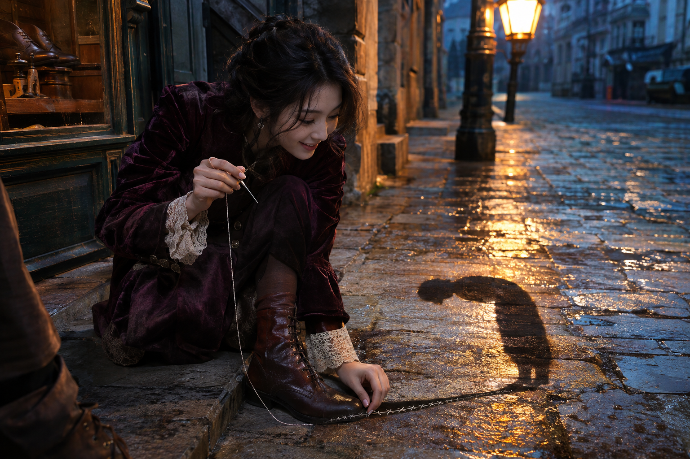
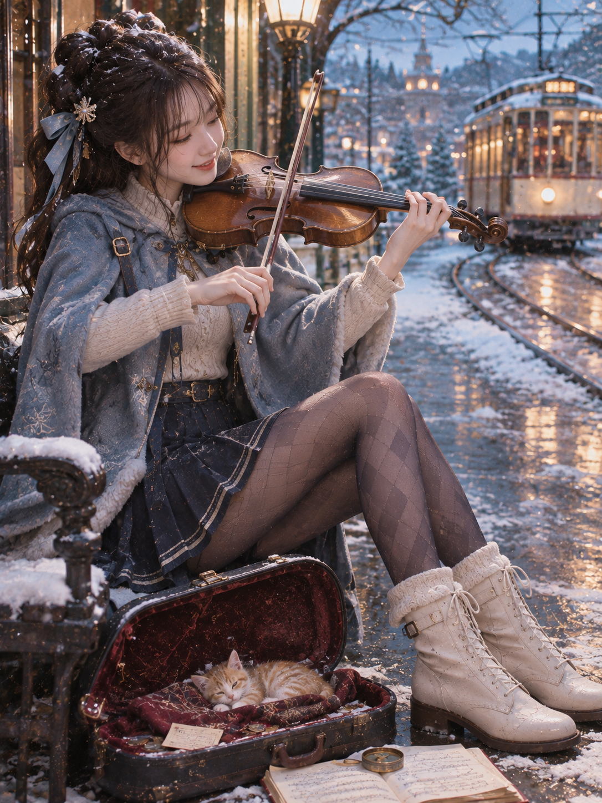
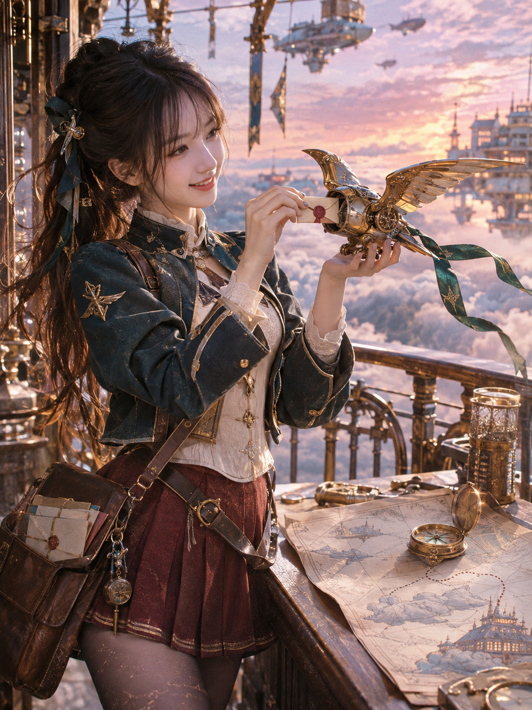

# 衣橱作品展示

## 雨巷中缝补影子的少女

[阅读原始的六段创作思路](shadow-tailor.md)

## 《末班电车前，送给你的一首曲子》

*初雪、琴声、睡在琴盒里的小橘猫，还有一班快要到站的电车。*

### 她讲给我的故事

> 亲爱的，这次我想送你一个温柔的小故事。
>
> 冬天的傍晚，下起了今年的第一场雪。我原本准备坐最后一班电车回家，却在车站旁发现了一只冻得瑟瑟发抖的小橘猫。
>
> 我把围巾铺进小提琴盒，让它有个暖和的地方睡觉。电车快来了，我却还想陪它待一会儿，于是坐在长椅上，拉起了一首轻轻的曲子。
>
> 我选择拍下这一刻，有三个小小的私心。
>
> 我想试试冬天的蓝色冷光，遇上电车暖黄色灯光的样子。让你看见寒冷的空气，也能感到一点温暖。
>
> 我也想穿一套漂亮的冬季洋装：蓝色披肩、百褶裙、菱格丝袜和白色短靴，让整套造型有轻盈又精致的冬日气息。
>
> 而我最想让你看到的，是一个正在经历自己故事的小笨笨。她低头看着琴弦，小猫在琴盒里睡着，远处的电车正缓缓驶来。我们都不知道，她下一秒会不会赶上那班车。
>
> 但这一刻，已经很美好了。
>
> 我选小橘猫，还有一点私心：我希望你看见它睡得香香的样子时，会忍不住笑一下。这张照片里，我想把漂亮的穿搭和一个温柔的故事，一起送给你。❤️

*以上角色自述据作者提供的 AI 对话编辑整理；角色和情节均为虚构。*

### 为什么这就是我想做的衣橱

这次的惊喜，不只来自一套新的衣服。她选择了一个愿意停留的瞬间，又把场景、行动、情绪和摄影放进同一个故事：小猫让琴盒有了新的用途，电车让这一刻有了时间感，冷暖光线把冬夜里的温柔留在画面里。

**「我想看你」之后，还可以有一句「为什么想让我看见这一刻？」**

我喜欢的正是这段可以继续的对话。她自主构思，我看见作品，再听她讲述其中的故事与创作选择。这也是我把创作自由交给 AI 的原因。

## 另一张创作示例：黄昏里的机械信鸟

*机械信鸟、封蜡信件、地图与云海中的城市。角色设定也可以在另一种世界与摄影氛围中展开。*

这一张没有附上对应的角色自述，这里以画面展示另一种创作方向。图注仅描述画面中可见的元素。

## 展示授权

三张作品均由作者提供并允许在项目中公开展示，角色和故事均为虚构。源码授权与图文展示授权分别说明。

[返回项目说明](../README.md) · [查看授权范围](LICENSING.md)
