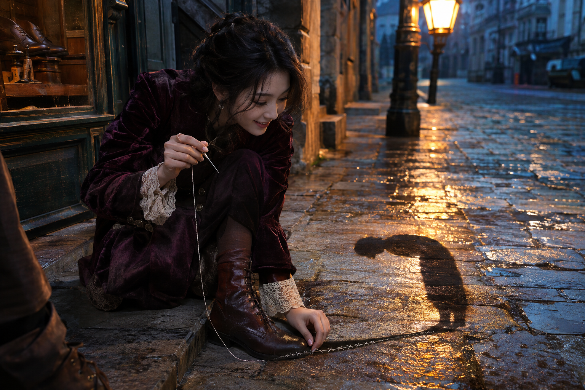

# 雨巷中缝补影子的少女

## 故事

黄昏的街上，影子可以走失，也能缝补。她终于将一条离家出走的影子带到主人的靴边，最后一针刚收线，影子却先自行弯腰向她致谢。这个世界里影子有自己的意愿，这是那一刻最小也最奇妙的证明。

## 情绪与动作

她单膝跪在石阶前，一手按平影子的破口，一手举着已经穿过最后一道针脚的细针。没想到薄薄的影子竟然鞠躬，她抬起眉毛，笑意刚从专注里露出来；不是夸张惊叫。

## 衣装

我给她设计了贴腰的茄紫色天鹅绒长外套裙，偏心排扣、窄腰带和精细蕾丝袖口，搭配实用的皮靴。完整世界还包括暗梅色绣花薄丝袜与工作工具，但不会为了展示一整套穿搭而夺走镜头对事件的注意。

## 摄影

摄影机放在鞋匠铺门槛边的低机位，以40毫米镜头同时看清她的侧脸、手中的针与地面道谢的影子。暖黄色老路灯在身后塑造影子的方向，冷蓝暮光照亮她的脸，湿石路保留自然反光。

## 画面线索

地上的银色针脚连接了破损影子的脚后跟与一只不动的靴子影子；另一处线索是影子低头鞠躬、实际主人仍站定不动。它们一起说明这是影子主动的感谢，而非人的动作投影。

## 成片复核

观察人物手指与缝纫动作是否有受力，针脚是否真正连到影子破口；影子与路灯位置是否合理，鞠躬是否看得出来。最重要的是它必须像偶然捕捉到的奇迹，而非一个穿戏服的人在摆拍。

*作者提供并授权公开展示的 AI 生成作品与原始创作说明。角色和故事均为虚构。*

[返回作品展示](README.md)
